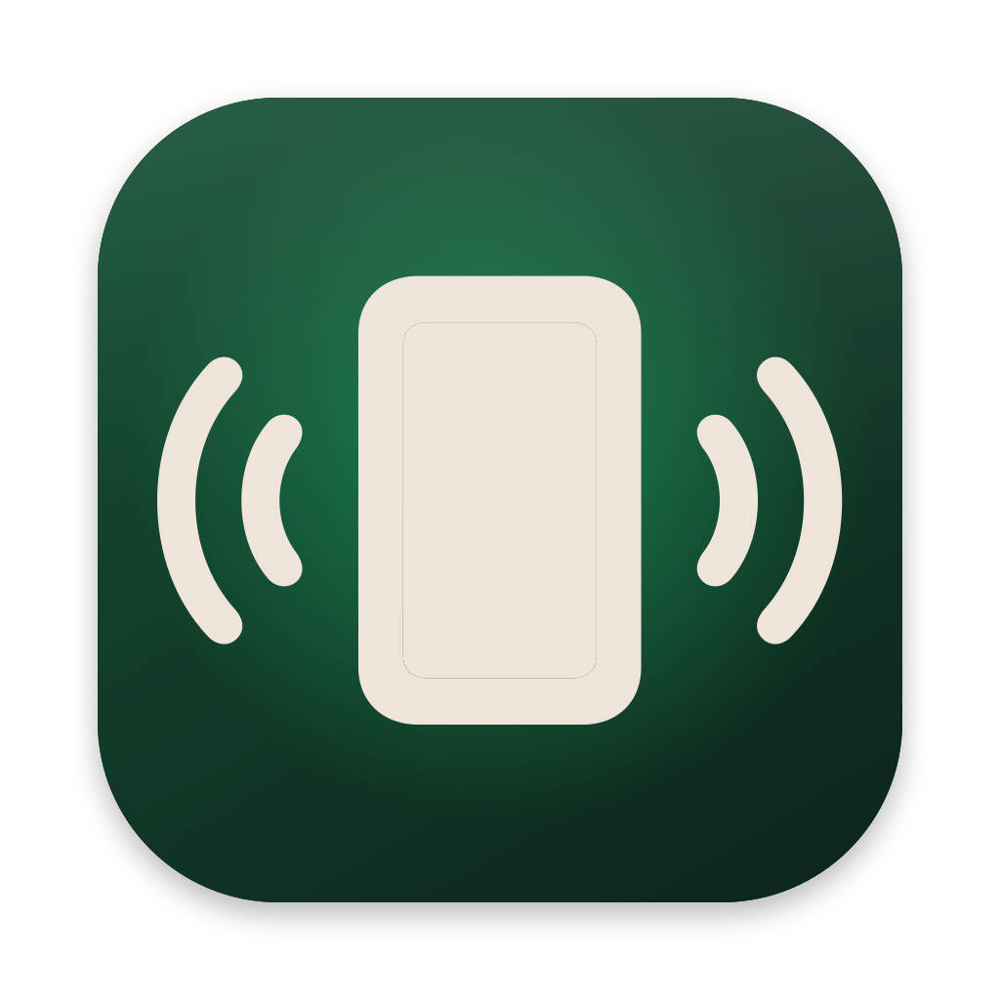
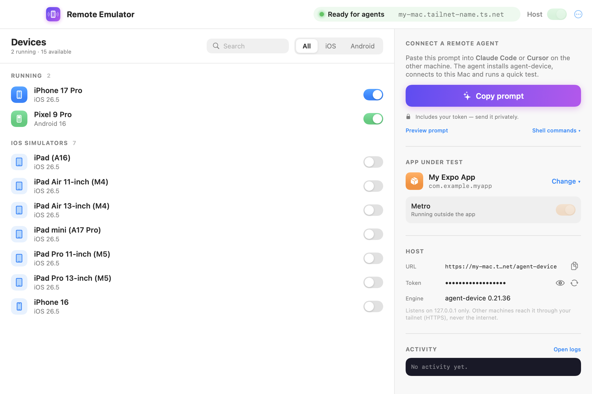
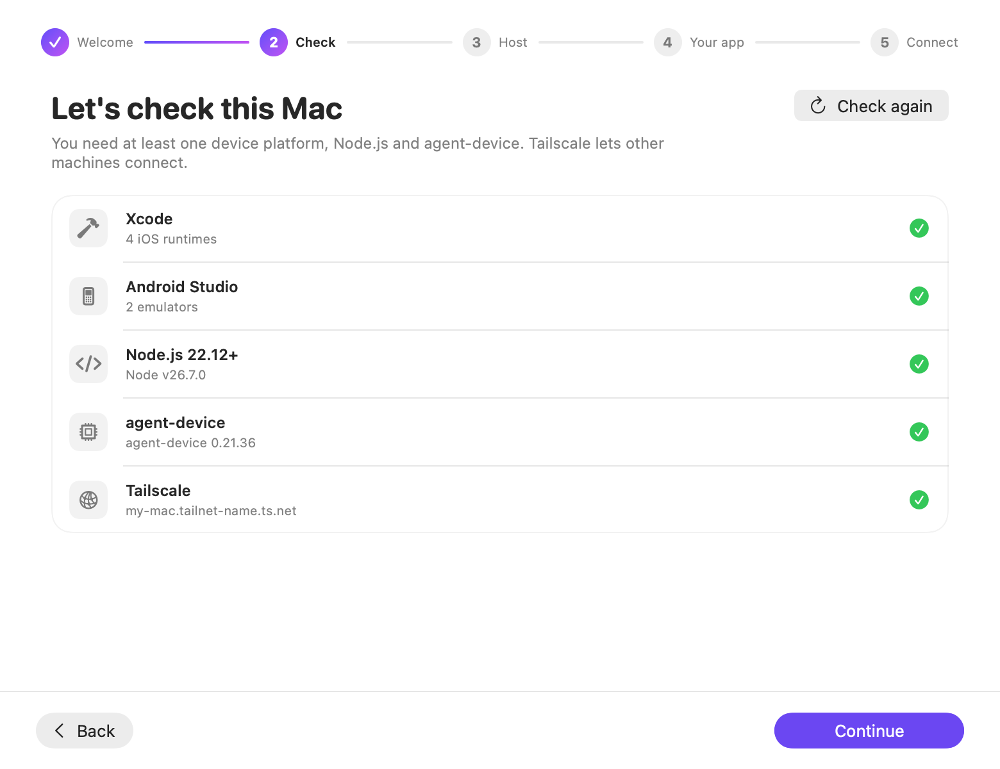

<div align="center">



# Remote Emulator

**Turn your Mac into a mobile device host for AI agents.**
Let Claude Code, Cursor or any agent on *another machine* drive the iOS simulators and
Android emulators on your Mac — privately, over Tailscale.

[](https://github.com/JcscJosecarlossilvacoelho/remote-emulator/actions/workflows/ci.yml)


[](https://buymeacoffee.com/JcscJosecarlossilvacoelho)





<sub><b>One window:</b> devices with on/off switches on the left — <i>Copy prompt</i>, your app, Metro and the host on the right. <b>Guided setup</b> on first launch.</sub>

</div>

## Why

AI coding agents are great at writing React Native / Expo code, but they need a device to
**see** what they built: tap through flows, take screenshots, read logs. Simulators only run
on macOS, and your agent often doesn't — it lives in a Linux VM, a Windows laptop, a cloud
box or a second Mac.

Remote Emulator is a native macOS app that makes your Mac the device host:

```
 Any machine (Claude Code / Cursor)                     Your Mac (Remote Emulator)
┌───────────────────────────────┐   HTTPS, tailnet only  ┌─────────────────────────────────────┐
│ agent-device CLI / MCP        │ ─────────────────────▶ │ tailscale serve                     │
│ AGENT_DEVICE_DAEMON_AUTH_TOKEN│     bearer token       │  └▶ agent-device proxy 127.0.0.1    │
└───────────────────────────────┘                        │       ├▶ iOS simulators  (Xcode)    │
                                                         │       └▶ Android emulators (SDK)    │
                                                         │ Metro (expo start) ◀── your app     │
                                                         └─────────────────────────────────────┘
```

It is a friendly control panel around [**agent-device**](https://agent-device.dev) by
Callstack (the engine that actually drives the devices) and
[**Tailscale Serve**](https://tailscale.com/kb/1242/tailscale-serve) (the private network).

## Features

- 🪄 **Guided setup** — a 5-step onboarding checks Xcode, Android SDK, Node.js, agent-device
  (one-click install) and Tailscale, starts the host and picks your app. Found an older
  terminal/launchd host? *Take over* archives it and runs everything from the app.
- 🤖 **Copy prompt** — the main button copies a ready-made prompt. Paste it into Claude Code or
  Cursor on the other machine and the agent installs agent-device, saves the token, connects,
  registers the MCP server and runs a smoke test by itself. (Plain shell commands are one menu away.)
- 📱 **Multi-device** — every iOS simulator and Android emulator on the Mac in one grid.
  Boot / shut down with a click, filter by platform, search, and see **which agent session
  is using which device** right now.
- 🛰 **One-click host** — starts the `agent-device` proxy on `127.0.0.1` and publishes it to
  your tailnet with HTTPS. Detects a host already running from a terminal or launchd.
- 🔐 **Private by default** — never binds to `0.0.0.0`, never uses Funnel/ngrok. A random
  256-bit token (file mode `0600`) protects every route except `/health`. Rotate it anytime.
- 📋 **Copy connect command** — ready-to-paste setup for macOS/Linux, Windows PowerShell or
  Claude Code MCP on the remote machine.
- 📦 **Metro manager** — pick any Expo / React Native app folder, start/stop Metro, see its
  iOS bundle id and Android package, switch between recent apps.
- 🧭 **Menu bar** — keeps serving devices after you close the window; quick status, running
  devices and actions from the menu bar.
- 📜 **Live logs** for the host and Metro, with the token redacted.

## Requirements

| On the Mac (host) | On the agent machine |
|---|---|
| macOS 14+ | Any OS with Node.js ≥ 22.12 |
| Xcode (iOS simulators) and/or Android Studio (emulators) | [Tailscale](https://tailscale.com/download), same tailnet |
| Node.js ≥ 22.12 + `npm i -g agent-device` | `npm i -g agent-device` (same version as the host) |
| [Tailscale](https://tailscale.com/download) with MagicDNS + HTTPS certificates | |

## Install

**One line** (downloads the latest release into `~/Applications` and opens it):

```sh
curl -fsSL https://raw.githubusercontent.com/JcscJosecarlossilvacoelho/remote-emulator/main/install.sh | bash
```

<details>
<summary>Manual download, or build from source</summary>

**Manual:** download `Remote-Emulator.zip` from the
[latest release](https://github.com/JcscJosecarlossilvacoelho/remote-emulator/releases/latest),
unzip, move to Applications. The app is open source but **not notarized** (that needs a paid
Apple Developer account), so macOS blocks it the first time: open **System Settings → Privacy &
Security** and click **Open Anyway**, or run
`xattr -dr com.apple.quarantine "/Applications/Remote Emulator.app"`.

**From source:**

```sh
git clone https://github.com/JcscJosecarlossilvacoelho/remote-emulator.git
cd remote-emulator
./scripts/build-app.sh --install     # → ~/Applications/Remote Emulator.app
```
</details>

## Quick start

1. **Open Remote Emulator** and follow the setup guide (requirements → host → app → connect).
2. **Boot the devices** you want agents to use (or let agents boot them).
3. Install your app once on each device: Expo Go, or a development build
   (`npx expo run:ios` / `npx expo run:android`).
4. Press **Copy prompt** and paste it into Claude Code / Cursor on the other machine (through a secure channel — it contains the token). The agent does the rest.

Prefer doing it by hand? On the agent machine:

```sh
export AGENT_DEVICE_DAEMON_AUTH_TOKEN='<token>'
export AGENT_DEVICE_SESSION=my-agent
agent-device connect proxy --daemon-base-url https://<your-mac>.<tailnet>.ts.net/agent-device

agent-device devices
agent-device open com.example.app --platform ios
agent-device snapshot -i              # accessibility tree with refs (@e1, @e2…)
agent-device press @e3 --settle       # tap
agent-device screenshot ./screen.png  # downloaded to the agent machine
agent-device close
```

For Claude Code, add the MCP server once:

```sh
claude mcp add --transport stdio --scope user agent-device -- agent-device mcp
```

Several agents can work at the same time: each one uses its own `AGENT_DEVICE_SESSION`, and
agent-device leases a different device to each session. The dashboard shows who holds what.

## Remote control: delegate whole tasks (optional, off by default)

Turn on **Remote control** in the sidebar, choose a projects folder (e.g. `~/WebstormProjects`) and
copy the **control prompt** for your agent. It can then, through your tailnet only:

- start / stop Metro for any app in that folder, and fast-forward the app's repo to a branch;
- run **Claude Code** or **Codex** headless *on this Mac*, inside one project folder (new folders
  allowed). Those runs drive the simulators themselves with agent-device and Metro with `re-metro`;
- download results such as screenshots (`GET /control/file?path=…`) to send them back in chat.

How runs are confined:

| | Claude Code | Codex |
|---|---|---|
| Writes | Project folder only (file tools + OS sandbox) | Project folder only (`workspace-write` sandbox) |
| Reads | Project folder + toolchains; rest of `~` denied | Not restricted by Codex's sandbox |
| Network | npm and GitHub only | Off |
| MCP / hooks | Off (`--strict-mcp-config`, `disableAllHooks`) | Your `config.toml` ignored; only agent-device MCP |
| Devices | `agent-device` runs outside the sandbox | agent-device MCP tools, pre-approved |
| Metro | `re-metro` (reads the token itself; the job never sees it) | Not available |

The control API has its **own token** (`~/.agent-device-host/control-token`), separate from the
simulator token, listens on 127.0.0.1:4320 and is published with `tailscale serve --set-path=/control`.
`app/update` refuses to touch uncommitted work but runs your package manager's install, so only
enable it for repos whose branches you trust.

## Security model

- The proxy listens on **127.0.0.1 only**. Remote access goes exclusively through
  `tailscale serve`, so only devices in **your tailnet** can reach it.
- Every request except `GET /health` needs the bearer token. Treat it like a password:
  anyone holding it can control your simulators. Rotate it from the Remote access card.
- The token lives in `~/.agent-device-host/token` (`0600`) and is redacted from the in-app logs.
- Want stricter rules? agent-device supports a policy file (allowed devices, denied commands):
  see [Remote proxy → Restricting clients](https://agent-device.dev/docs/remote-proxy).

## Files

| Path | What |
|---|---|
| `~/.agent-device-host/token` | Proxy bearer token (shared with terminal setups) |
| `~/.agent-device-host/app-dir` | Active app folder for Metro |
| `~/.agent-device-host/control-token` | Remote-control token (separate secret) |
| `~/.agent-device-host/bin/re-metro` | Metro helper used by Claude Code runs |
| `~/.agent-device-host/proxy.log` | Proxy output (token redacted) |
| `~/.agent-device/` | agent-device state, sessions and logs |

## Troubleshooting

| Symptom | Fix |
|---|---|
| *Local only — start Tailscale to share* | Start Tailscale; enable MagicDNS and HTTPS certificates in the admin console. |
| Host shows *Managed outside the app* | A proxy started from a terminal/launchd already owns the port. Stop it there, or keep using it. |
| *Proxy answers but its daemon does not* | The agent-device daemon exits after 5 min idle by default. Remote Emulator starts it with `AGENT_DEVICE_DAEMON_IDLE_TIMEOUT_MS=0` and self-heals; for a host started elsewhere, export that variable before `agent-device proxy`. |
| Remote gets `401` | Token mismatch — copy the connect command again after rotating. |
| Remote gets `REMOTE_SESSION_REQUIRED` | Set `AGENT_DEVICE_SESSION` (or pass `--session`). |
| Android app can't reach Metro | Remote Emulator runs `adb reverse tcp:8081` when Metro starts; restart Metro after booting a new emulator. |
| Expo Go on Android: `Cannot find native module 'ExpoTopicSubscriptionModule'` | Expo Go no longer supports push on Android (SDK 53+). Use a development build. |

## Roadmap

- [ ] Signed & notarized releases + Homebrew cask (needs sponsors for the Apple Developer fee ☕)
- [ ] Create / delete simulators and AVDs from the app
- [ ] Per-device policy editor (allowed commands, read-only agents)
- [ ] Live device thumbnails
- [ ] Physical iOS / Android devices
- [ ] Linux host (Android-only) companion

## Contributing

PRs and issues are very welcome — see [CONTRIBUTING.md](CONTRIBUTING.md).

```sh
swift build && swift run RemoteEmulator   # run from source
swift test                                # unit tests
```

## Support

Remote Emulator is free and open source. If it saves you time (or a $299/month cloud
simulator bill), you can [**buy me a coffee ☕**](https://buymeacoffee.com/JcscJosecarlossilvacoelho)
— it helps pay for an Apple Developer account so releases can be signed and notarized.

## Credits

- [agent-device](https://github.com/callstack/agent-device) by Callstack — the device automation engine.
- [Tailscale](https://tailscale.com) — private networking.
- [Expo](https://expo.dev) — the app framework this was first built for.

Remote Emulator is an independent project, not affiliated with Callstack, Tailscale, Expo or Apple.

## License

[MIT](LICENSE) © 2026 [José Coelho](https://josecoelho-dev.vercel.app)
